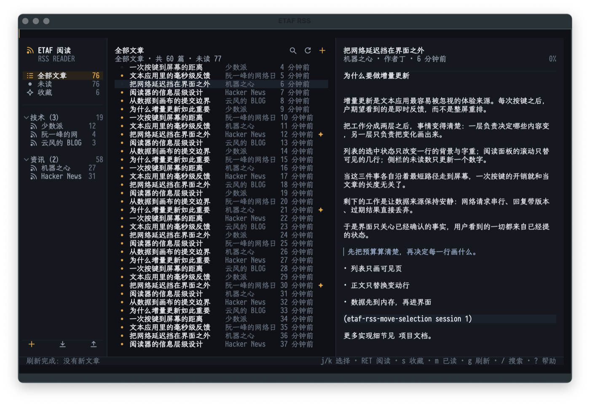
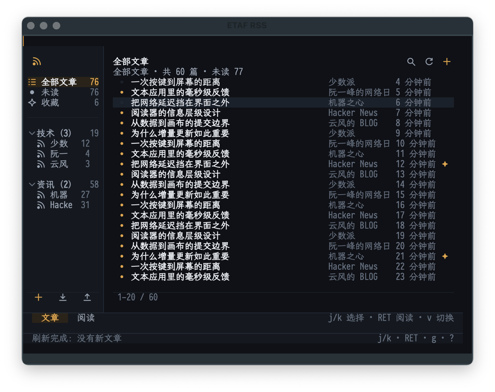
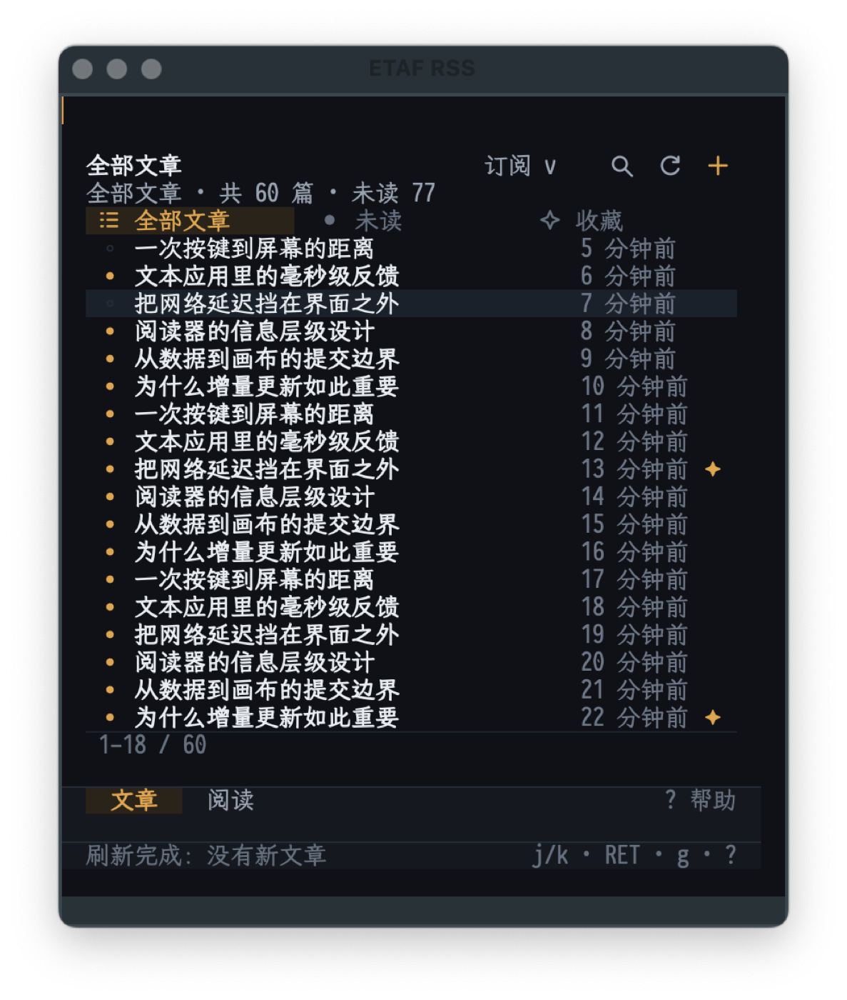

# ETAF RSS

ETAF RSS is a complete RSS client for Emacs, rendered as one ETAF text
application. It subscribes to RSS 2.0, Atom and JSON Feed documents, keeps
every subscription and article in one local JSON store, browses all/unread/
starred scopes plus per-feed and per-folder lists, reads an article as wrapped
text, tracks read and starred state, searches titles and bodies, and imports
and exports OPML. Refresh is conditional (ETag / Last-Modified) and runs one
request at a time in the background.

The reader at a wide frame:



At a medium frame the subscription sidebar narrows and one content pane is
shown at a time:



At a narrow frame the scopes move into a header strip:



## Capabilities

- Subscriptions: add a feed by URL, or by a site page and its advertised feed
  link; unsubscribe; file a subscription under a folder; collapse folders.
- Full text: subscribe to any feed URL, so a converter such as
  [morss](https://github.com/pictuga/morss) can turn summary-only feeds into
  full articles; links keep pointing at the original site.
- Reading: all / unread / starred scopes, per-feed and per-folder lists,
  newest first, with unread and starred state carried by colour and weight.
- The reading pane renders the article's own HTML as wrapped blocks:
  headings, paragraphs, quotes, lists, code, table rows and collected links;
  `o` opens the original in the browser.
- Read state: an article is marked read after it stays open; `m` toggles it,
  `A` marks the whole scope read, `M` marks everything above the selection;
  starred articles survive unsubscribing.
- Search: case-insensitive terms over titles, summaries and bodies, with a
  snippet of the matching passage.
- OPML: import and export subscriptions with their folders.
- Refresh: local reload plus a background feed-by-feed refresh; conditional
  requests, per-feed errors shown in the sidebar, an idle timer, and a manual
  `R` for every subscription.
- Appearance: dark and light palettes published as ETAF UI theme tokens, so
  shared controls follow the reader.
- Layout: three responsive breakpoints (sidebar + list + reader, narrow
  sidebar + one pane, scope chips + one pane); every control is reachable
  with the keyboard, the mouse and the wheel.
- Headless: a session needs no buffer, no network and no timer, and accepts a
  scripted client, so scripts and tests drive the whole reader offline.

## Keys

| Key | Action |
| --- | --- |
| Arrows | select the next / previous article |
| `n` / `p` | next / previous unread article |
| `RET` | open the selected article (compact layout switches to the reader) |
| `SPC` / `C-v`, `M-v` | scroll the article (or page the list on a compact list) |
| `<next>` / `<prior>` | page the article list |
| `s` | star / unstar |
| `m` | toggle read |
| `A` | mark the current scope read |
| `M` | mark the selection and everything above it read |
| `o` | open the original in the browser |
| `/` | search |
| `1` / `2` / `3` | all / unread / starred |
| `a`, `d` | subscribe, unsubscribe |
| `i`, `e` | import, export OPML |
| `v` | switch list / reading pane on a compact layout |
| `g` / `R` | refresh the current scope / every subscription |
| `T` | dark / light palette |
| `?` / `C-c h` | searchable key help inside the reader |
| `q` | close the reader |

Help uses the reader's own theme and window. Search with `/`; Escape leaves
search editing before closing help. Clicking the dimmed background also closes
it and restores the previous focus.

## Prerequisites

| Requirement | Why | Check |
| --- | --- | --- |
| Emacs 29.1 or newer with libxml2 | renders the interface and parses feeds | `(featurep 'libxml-parse-xml-region)` |
| `etaf`, `etaf-ui`, `ebox`, `ecss` | the framework; each repository's root entry must be on `load-path` | every checkout is readable |

No external program and no account is required: feeds are fetched with Emacs'
own `url-retrieve`, and the store is one JSON file.

## Installation

```elisp
(add-to-list 'load-path "/path/to/etaf")
(add-to-list 'load-path "/path/to/etaf-ui")
(add-to-list 'load-path "/path/to/ebox")
(add-to-list 'load-path "/path/to/ecss")
(add-to-list 'load-path "/path/to/etaf-rss")
(require 'etaf-rss)

(global-set-key (kbd "C-c r") #'etaf-rss-open)
```

`M-x etaf-rss-open` mounts the reader in the selected window and fills it;
`M-x etaf-rss-close` closes it. The first run starts with an empty reader:
press `a` to subscribe to a feed address, or `i` to import an OPML file. The
store lives in `<user-emacs-directory>/etaf-rss/data.json`; bind
`etaf-rss-data-file` before creating a session to keep profiles apart.

## Quick start for an agent

A non-interactive path to a working reader, with no network:

```sh
emacs -Q --batch -L . -L lisp -L ../etaf -L ../etaf-ui -L ../ebox -L ../ecss \
      -l examples/etaf-rss-demo.el
```

The demo injects a scripted client, walks refresh, reading, starring and
search, and prints the state after every step.

## Documentation

- [User manual](docs/manual.md): workflows, configuration, failure recovery.
- [Architecture](docs/architecture.md): responsibilities, dependency direction
  and invariants of the implemented system.
- The package entry `etaf-rss.el` is the authoritative public API inventory.

## Development

```sh
make check            # structure, compilation, public API and acceptance
make api-check        # entry bindings and signatures only
make test             # acceptance scenarios only
make check EMACS=/path/to/emacs
```

The acceptance scenarios drive the real service layer over `file://` fixtures,
so they need no network while still exercising fetch, parse, merge, scopes,
reading, search and OPML. Performance workloads live in
`benchmarks/performance-scenarios.el` and run through the workspace driver:

```sh
python3 ../../scripts/performance.py run --mode gui \
  --scenario-file benchmarks/performance-scenarios.el \
  --scenario 'etaf-rss.*' --diagnose
```
